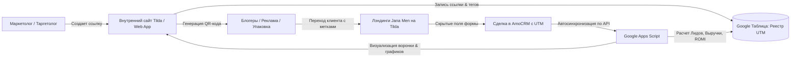

# Руководство по интеграции UTM-реестра с Tilda и AmoCRM

Данное руководство объясняет, как за 5 минут развернуть внутренний портал для регистрации UTM-меток на платформе **Tilda**, настроить сквозную передачу данных в **AmoCRM** и автоматический расчет окупаемости каналов.

---

## 1. Архитектура решения



---

## 2. Размещение портала на внутреннем сайте Tilda

Вы можете встроить готовый веб-интерфейс генератора и дашборда на любую страницу вашего внутреннего сайта в Tilda (например, `intra.janamen.kz/utm`).

### Шаг 1: Добавление блока на Tilda
1. Откройте нужную страницу в редакторе Tilda.
2. Добавьте блок **«Другое» → T123 («HTML-код»)**.
3. Нажмите кнопку **«Контент»** в блоке и вставьте следующий код:

```html
<div style="width: 100%; max-width: 1240px; margin: 0 auto; padding: 20px 0;">
  <iframe 
    src="https://script.google.com/macros/s/AKfycbwV97KvjNwl_OCWbydMTd7DVFn6mDSRvjj6-z5nhdlQK8v9XliGC6JFW6NHZSY0p3Jz/exec" 
    width="100%" 
    height="950" 
    frameborder="0" 
    style="border: 1px solid #e2e8f0; border-radius: 16px; box-shadow: 0 10px 25px -5px rgba(0, 0, 0, 0.05); background: #ffffff;"
    allow="clipboard-write">
  </iframe>
</div>
```

4. Опубликуйте страницу. Портал полностью готов к работе!

---

## 3. Настройка форм на лэндингах Jana Men (Tilda → AmoCRM)

Чтобы заявки с рекламы и от блогеров автоматически попадали в AmoCRM с заполненными UTM-метками:

### Для стандартных блоков с формами Tilda (BF101, BF204 и др.):
1. Откройте блок с формой → нажмите **«Контент»** → **«Поля для ввода»**.
2. Нажмите **«Добавить поле для ввода»** и выберите тип: **`Скрытое поле (Hidden field)`**.
3. Создайте 5 скрытых полей с такими именами переменных:
   - Имя переменной: `utm_source`
   - Имя переменной: `utm_medium`
   - Имя переменной: `utm_campaign`
   - Имя переменной: `utm_content`
   - Имя переменной: `utm_term`
4. В настройках формы оставьте значение по умолчанию пустым — Tilda автоматически подставит значения из адресной строки браузера при клике по ссылке.
5. В разделе **«Формы»** подключите интеграцию с **AmoCRM**. Tilda сопоставит скрытые поля со стандартными системными полями AmoCRM (`UTM Source`, `UTM Medium` и т.д.).

### Для Zero Block:
1. Откройте форму внутри Zero Block.
2. Добавьте те же скрытые поля с переменными `utm_source`, `utm_medium`, `utm_campaign`, `utm_content`, `utm_term`.

---

## 4. Как работает автоматический расчет аналитики

1. **Реестр UTM (`🎯 Реестр UTM`)**:
   - Каждая созданная ссылка получает уникальный `ID` (например, `UTM-0001`).
   - Фиксируются `Базовый URL`, `utm_source`, `utm_medium`, `utm_campaign`, `utm_content`, `utm_term`, `Тег` и плановый `Бюджет (₸)`.

2. **Сделки AmoCRM (`📥 Сделки AmoCRM`)**:
   - Скрипт периодически (или по кнопке «Синхронизировать CRM») скачивает лиды из AmoCRM.
   - Определяет статус: `Оплачено / Доставлено` (статусы 142 и 87065486), `В работе` или `Отказ`.
   - Записывает бюджет сделки, дату, воронку, менеджера и UTM-метки.

3. **Связка и сквозная воронка**:
   - В Реестре формулы `COUNTIFS` и `SUMIFS` связывают сделки из AmoCRM с соответствующей строкой кампании:
     - **Лидов (CRM)**: количество входящих заявок по этой связке меток.
     - **Оплат (CRM)**: количество успешно реализованных и доставленных заказов.
     - **Выручка (₸)**: сумма фактически оплаченных заказов.
     - **Конверсия (CR %)**: `Оплаты / Лиды * 100%`.
     - **CPL (₸)**: `Расход / Лиды`.
     - **CAC (₸)**: `Расход / Оплаты`.
     - **ROMI (%)**: `(Выручка - Расход) / Расход * 100%`.

4. **Дашборд (`📊 Сквозная Аналитика` и Веб-приложение)**:
   - Сводные карточки всех показателей компании в режиме реального времени.
   - Сравнительный анализ площадок (Instagram, TikTok, FB, Telegram, Kaspi).
   - Рейтинг прибыльности блогеров и креативов.
